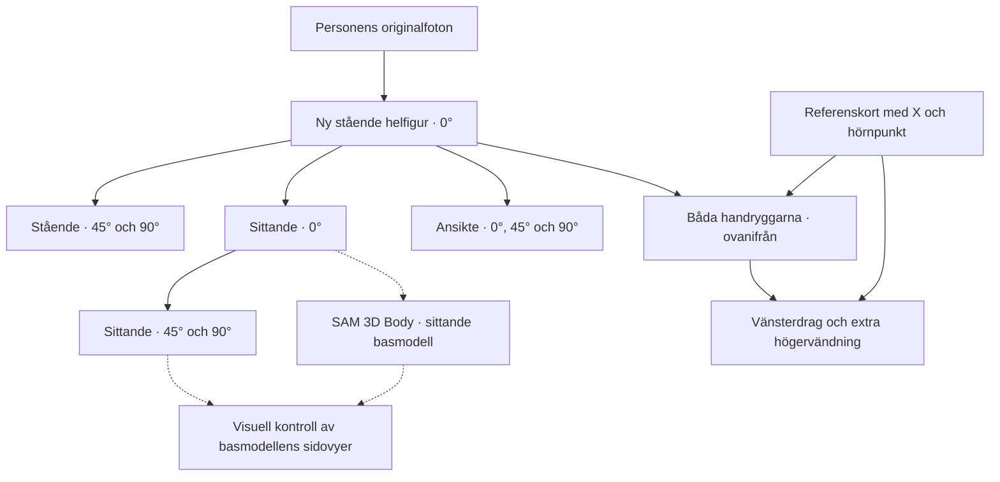

# Från blandade foton till en dealer

[Öppna beställningen i studion](http://127.0.0.1:4317/bildpipeline). Lägg in foton av samma person. Fyra selfies, helbilder och sidovyer kan blandas i ett utkast. En ny stående helfigur rakt framifrån är alltid första resultatet. Kropp, skor och klädytor som saknas i originalen blir uppskattningar. Granska sådana detaljer innan fronten används som referens för nästa dealerprov.

Varje Runway-steg får också alla ursprungsfoton i den sparade ordningen. I ett följdsteg är den gemensamma genererade basbilden referens 1. När ett kort ingår bifogas dess tryck sist. De parallella sidovyerna utgår var för sig från samma front. API-modellen använder referensernas positioner i listan. Den engelska prompten anger vad varje bild bidrar med. [Prompter för alla tolv vyer](../studio/fotomall/runway-bildprompter.ts) · [Runways API-kontrakt](https://docs.dev.runwayml.com/api.md)

## Format och pris

Betan använder `gpt_image_2_6_sunburst`, PNG, ogenomskinlig bakgrund, 4K, hög kvalitet och hög resonemangsnivå. Varje anrop till `POST /v1/text_to_image` begär ett resultat. Upp till 14 original ryms tillsammans med en tidigare vinkel och korttrycket inom modellens gräns på 16 referenser. Överstora bildreferenser får en lokalt nedskalad transportkopia. Originalets bytes bevaras.

| Vyer | Leverans i pixlar | Grundpris per bild |
| --- | --- | ---: |
| Stående, sittande och porträtt | 2448 × 3264, 3:4 | 14 krediter |
| Handryggar och extra högervändning | 3504 × 2336, 3:2 | 13 krediter |
| Vänsterdrag | 3840 × 2160, 16:9 | 11 krediter |

Varje referens kostar ytterligare en API-kredit per bild. Med fyra original kostar ståfronten uppskattningsvis **18 krediter**. Hela serien med elva grundbilder och en vändning kostar uppskattningsvis **225 krediter**, inklusive ståfronten. Kostnaden i studion följer antalet valda original. [Runways API-pris per format](https://docs.dev.runwayml.com/guides/pricing/#image-generation-pricing)

## Granskning och fortsättning

1. Spara ett lokalt utkast. Varje steg visar modell, prompt, målformat, ordnade referenser och pris.
2. Skicka ståfronten för ett första kvalitetsprov och välj **Fortsätt serien** när den ser rätt ut. **Skicka hela serien** beställer också ståfronten först och fortsätter på samma revision.
3. Låt revisionen vara öppen under körningen. När vyn öppnas igen återupptas statuskontrollen. Studion behåller Runways jobb-ID och bildoriginal på labbdisken. Vid en osäker beställning kan rätt jobb-ID från Runway kopplas till steget. Efter ett definitivt fel går det att skapa ett nytt utkast från samma foton.
4. En sittande SAM-modell kan skattas från den färdiga sittfronten. Kamerorna på 45° och 90° ger jämförelsebilder för rygg, höft, knän och handplacering. Paulinas första kroppsprov för Fas 1 använder hennes befintliga upplaga. [Projektets aktuella överlämning](HANDOFF.md)
