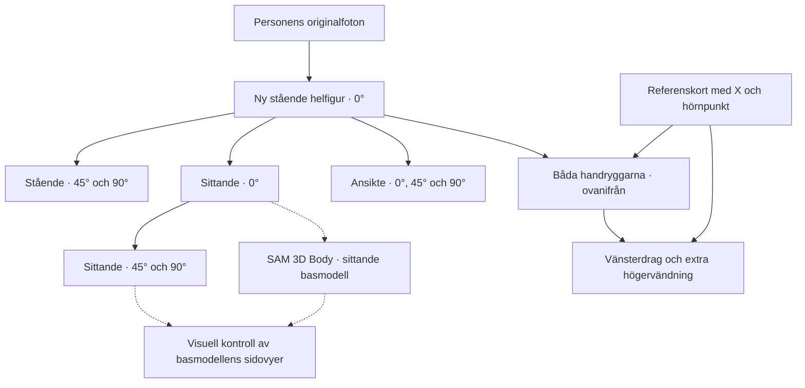

# Från blandade foton till en dealer

[Öppna beställningen i studion](http://127.0.0.1:4317/bildpipeline). Lägg in foton av samma person. Fyra selfies, helbilder och sidovyer kan blandas i ett utkast. En ny stående helfigur rakt framifrån är alltid första resultatet. Kropp, skor och klädytor som saknas i originalen blir uppskattningar. Granska sådana detaljer innan fronten används som referens för nästa dealerprov.

Varje Runway-steg får också alla ursprungsfoton i den sparade ordningen. I ett följdsteg är den gemensamma genererade basbilden referens 1. När ett kort ingår bifogas dess tryck sist. De parallella sidovyerna utgår var för sig från samma front. API-modellen använder referensernas positioner i listan. Den engelska prompten anger vad varje bild bidrar med. [Prompter för alla tolv vyer](../studio/fotomall/runway-bildprompter.ts) · [Runways API-kontrakt](https://docs.dev.runwayml.com/api.md)

## Format och pris

Betan använder `gpt_image_2_6_sunburst`, PNG, ogenomskinlig bakgrund, 4K, hög kvalitet och hög resonemangsnivå. Varje anrop till `POST /v1/text_to_image` begär ett resultat. Upp till 14 original ryms tillsammans med en tidigare vinkel och korttrycket inom modellens gräns på 16 referenser. Överstora bildreferenser får en lokalt nedskalad transportkopia. Originalets bytes bevaras.

| Vyer | Leverans i pixlar | Grundpris per bild |
| --- | --- | ---: |
| Stående, sittande och porträtt | 2448 × 3264, 3:4 | 14 krediter |
| Handryggar och extra högervändning | 3504 × 2336, 3:2 | 13 krediter |
| Vänsterdrag | 3840 × 2160, 16:9 | 11 krediter |

Varje referens kostar ytterligare en API-kredit per bild. Med fyra original kostar ståfronten uppskattningsvis **18 krediter**. Hela serien med elva grundbilder och en vändning kostar uppskattningsvis **225 krediter**, inklusive ståfronten. Kostnaden i studion följer antalet valda original. [Runways API-pris per format](https://docs.dev.runwayml.com/guides/pricing/#image-generation-pricing)

Studions bildrecept och API-utkast läser pixelmåtten från samma formatdefinition. Paulinas sittserie v1 levererades i 1083 × 1452 px. Studion mäter dess original och visar nästa series målformat separat. [Format i studion](../studio/fotomall/bildformat.ts)

## Sittserie och kamerakontroll

Utgå från samma sittfront, stol och fotplacering. Linscentrum ligger på sittande brösthöjd. Behåll höjden över golvet, brännvidden och radien till stolens mitt vid 0°, 45° och 90° i sidled. Den optiska axeln hålls vågrät. Vid verklig fotografering dokumenteras höjd, brännvidd, utsnitt och en måttsatt referens i ett gemensamt golvkoordinatsystem i varje kameraläge. Det ger underlag för att bestämma kamerans läge. För en AI-bild är promptens kameravärden önskemål. [Kamerakalibrering och projektion i OpenCV](https://docs.opencv.org/4.x/d9/d0c/group__calib3d.html)

| Kontroll i studion | Projektets första granskningsgräns |
| --- | --- |
| Originalformat inom serien | Identisk bredd och höjd för de tre sittvyerna. |
| Kroppens storlek i bilden | Hjässa–sula inklusive ändrader, delat med originalets höjd. Granska en relativ skillnad över 2 % (20 ‰) mot frontens andel. Reglaget provar andra gränser. |
| Utsnittets höjdläge | Granska om mittpunkten mellan hjässa och sula förskjuts över 1 % av hela bildhöjden mot fronten. |
| Stolens golvkontakter | Markera trampytornas mitt i originalpixlar. Ange synlig kant för delvis skymda fötter. Redovisa x- och y-spannet för synliga mittpunkter och deras antal. Fyra synliga centrum ger hela stolens bildspann. Perspektivet ändras med sidovinkeln. |
| Modellkamera | Visa sidovinkel, höjdvinkel, höjd över scengolvet, riktpunkt, avstånd och zoom. Markera en vy mer än 1° från receptets sidovinkel eller vågräta axel. |
| Ögonens bildläge | Jämför pupillens höjd i fotooriginalet med projektionen av motsvarande ögonled i 3D-rutan. I sittreceptets kameraläge granskas över 2 procentenheters skillnad. Runt gränsen används fotopunktens skattade avläsningsosäkerhet. |

I varje bildutgåva hämtas hjässa, sula och synlig sitskant ur `sittande-bildskala.json`. För de visuella kontrollerna lagras originalpixlar räknade från vänster och ovan i `sittande-kamerapunkter-v1.json`. Filnamn, utgåva, bildmått och SHA-256 måste matcha originalet. Vid byte av foto behövs ny avläsning. Geometriskt bildcentrum och en referenspunkt på en stol räcker inte för att bestämma den fotograferande kamerans lutning. [Paulinas uppmätta sittserie](http://127.0.0.1:4317/bildstandard/sitthojd) · [Gemensamma kontrollregler](../studio/lib/seated-review.ts)

## Granskning och fortsättning

[Kontroll av bildutgåvan](http://127.0.0.1:4317/bildstandard#utgavekontroll) läser varje originalfils SHA-256 och verkliga pixelmått. I bildutgåvans `utgavegranskning-v1.json` kopplas bedömning, synlig avvikelse och eventuellt korttryck till utgåva, filnamn och samma SHA-256. En ersatt bild behöver granskas på nytt. Bildmålen hämtas från samma recept som beställningsvyn. Den ifyllda JSON-mallen innehåller originalens bildbedömningar.

I Paulinas Fas 1 v1 är samtliga 12 original verifierade. Alla tre porträtt fungerar som referenser. De tre handbilderna visar kort med vit ram och vit punkt. Ingen har X-trycket som gäller för nya foton. Alla 12 har andra pixelmått än dagens leveransrecept. Sittfronten gav kroppen, och sittbilderna från sidan användes för att passa hållningen. Tre sittbilder, tre porträtt och båda handryggarna gav tillsammans fotoytan på v2. Stillbilder av kortgreppet hjälper oss att bedöma hur fingrarna omsluter kanten. Tidsförloppet kommer från den animerade riggen och kortets egen bana. [Bildens roll i modellen](http://127.0.0.1:4317/#modellering)

1. Spara ett lokalt utkast. Varje steg visar modell, prompt, målformat, ordnade referenser och pris.
2. Skicka ståfronten för ett första kvalitetsprov och välj **Fortsätt serien** när den ser rätt ut. **Skicka hela serien** beställer också ståfronten först och fortsätter på samma revision.
3. Låt revisionen vara öppen under körningen. När vyn öppnas igen återupptas statuskontrollen. Studion behåller Runways jobb-ID och bildoriginal på labbdisken. Vid en osäker beställning kan rätt jobb-ID från Runway kopplas till steget. Efter ett definitivt fel går det att skapa ett nytt utkast från samma foton.
4. En sittande SAM-modell kan skattas från den färdiga sittfronten. Kamerorna på 45° och 90° ger jämförelsebilder för rygg, höft, knän och handplacering. Paulinas första kroppsprov för Fas 1 använder hennes befintliga upplaga. [Projektets aktuella överlämning](HANDOFF.md)
